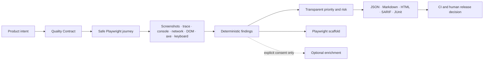
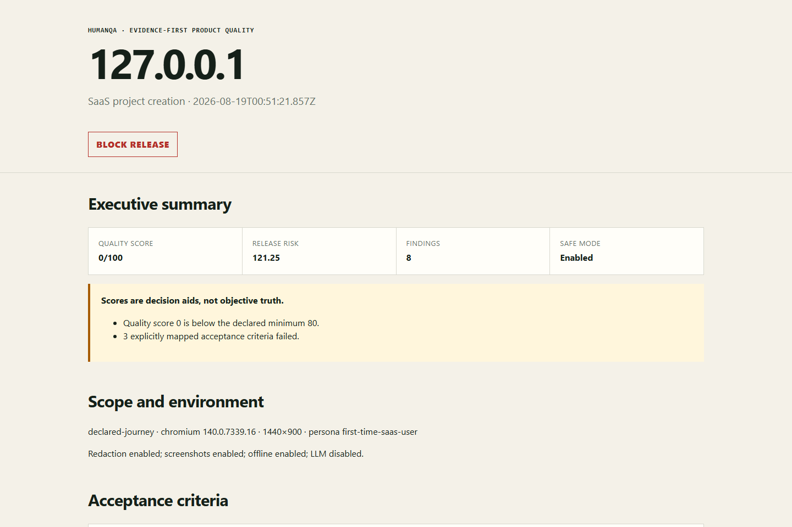
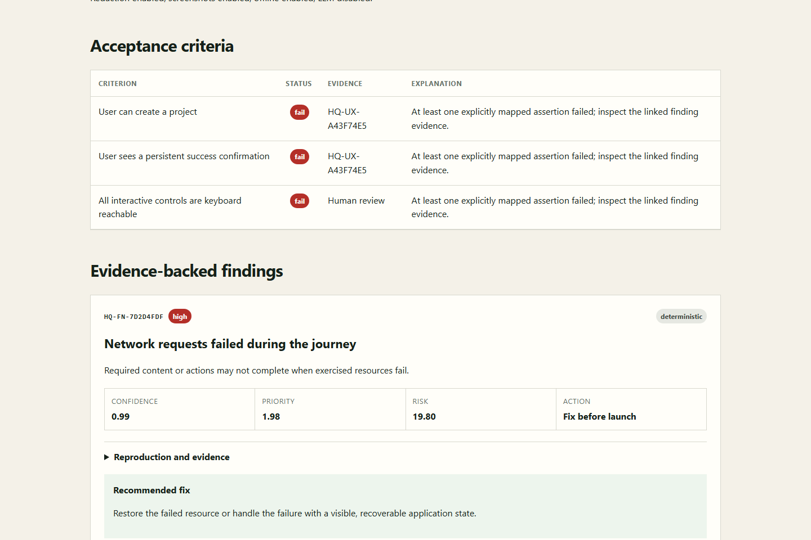

<p align="center">
  
</p>
<p align="center">
  
</p>

# HumanQA

[](https://github.com/Hotragn/humanqa/actions/workflows/ci.yml)
[](https://www.npmjs.com/package/humanqa)
[](https://www.npmjs.com/package/@humanqa/cli)
[](LICENSE)
[](CONTRIBUTING.md)

**Evidence-first product quality checks for web apps.**

[Website](https://humanqa-oss.vercel.app/) · [Documentation](https://humanqa-oss.vercel.app/docs/) · [Validation report](docs/validation/release-validation.md) · [Brand system](docs/brand-system.md)

Turn product requirements and live user journeys into:

- reproducible Playwright tests,
- UX and accessibility findings with screenshots and traces,
- PM-ready priorities,
- CI release gates.

```bash
npx humanqa install-browser
npx humanqa init --name "My web application" --url https://staging.example.test
npx humanqa verify --config humanqa.yml
```

`init` creates both `humanqa.yml` and a validated local smoke journey, so npm users do not need to clone this repository or copy a pack before their first Quality Contract run.

`humanqa` keeps the memorable `npx humanqa` command. The identical official CLI is also published as [`@humanqa/cli`](https://www.npmjs.com/package/@humanqa/cli) under the HumanQA npm organization.

> From “we think it works” to “here is the trace, evidence, and regression test.”

HumanQA v0.1 is deliberately narrow: it runs a **declared, safe journey** and connects product intent to deterministic browser evidence. It does not pretend to understand arbitrary applications or replace human usability and accessibility research.

## See it in 60 seconds

```bash
git clone https://github.com/Hotragn/humanqa.git
cd humanqa
corepack enable
pnpm install
pnpm humanqa install-browser

# Terminal 1: intentionally broken local fixture
pnpm demo

# Terminal 2: evidence bundle and release verdict
pnpm humanqa audit http://127.0.0.1:4173 \
  --persona first-time-saas-user \
  --goal "Create a disposable project" \
  --journey packs/journeys/saas-project-creation.yaml
```

Open the printed `report.html`, then generate a safe test scaffold:

```bash
pnpm humanqa generate-test humanqa-output/<timestamp>/report.json
```

Broken mode seeds an unlabeled field, keyboard blockage, horizontal overflow, failed request, missing success confirmation, ambiguous CTAs, and a broken link. Restart with `pnpm --filter @humanqa/demo-dashboard dev:fixed` to inspect the paired corrected state.

The demo performs no real signup, project creation, payment, or persistent mutation. Its “create” action is local browser state in a disposable fixture.

## Why HumanQA exists

Playwright is excellent execution infrastructure. axe-core is excellent automated accessibility analysis. Browser traces are excellent debugging artifacts. HumanQA adds the missing quality layer between them:



Every definite finding must carry a named rule and inspectable evidence. AI enrichment is optional, off by default, and excluded from deterministic gates.

## Quality Contracts

`humanqa.yml` connects intended product behavior to an executable journey and explicit thresholds:

```yaml
project:
  name: Example SaaS
  baseUrl: http://127.0.0.1:4173

defaults:
  safeMode: true
  redact: true
  screenshots: true
  browser: chromium
  offline: false
  viewport: { width: 1440, height: 900 }
  mobile: false

quality_contracts:
  - id: project-creation-complete
    name: First project creation works
    persona: first-time-saas-user
    journey: packs/journeys/saas-project-creation.yaml
    acceptance_criteria:
      - User can create a project
      - User sees a persistent success confirmation
      - All interactive controls are keyboard reachable
      - No critical accessibility violations are present
    thresholds:
      max_duration_seconds: 120
      max_critical_findings: 0
      min_quality_score: 80
```

HumanQA returns `pass`, `fail`, or `review` for each criterion. Unmapped prose never passes by implication.

## CLI

```text
humanqa init
humanqa audit <url>
humanqa audit <url> --persona <id> --goal "<goal>"
humanqa audit <url> --journey <path>
humanqa verify --config humanqa.yml
humanqa generate-test <report.json>
humanqa list-packs
humanqa validate-pack <path>
humanqa install-browser [--with-deps]
humanqa doctor [--json]
humanqa github comment --report <report.json> --dry-run
```

Useful audit controls:

```bash
humanqa audit http://127.0.0.1:4173 --offline
humanqa audit https://staging.example.test --no-screenshots
humanqa audit https://staging.example.test --viewport 390x844 --mobile
humanqa audit https://staging.example.test --no-redact       # explicit privacy review required
humanqa audit https://staging.example.test --allow-mutations # disposable test environments only
```

Safe mode, redaction, and screenshots are enabled by default. `--offline` permits only a loopback target and blocks cross-origin requests. Goal-only audits inspect one page conservatively; declared journeys are required for strong completion claims.

`humanqa init --url <authorized-url> --name <project>` creates a self-contained starter under `humanqa/journeys/`. Review that journey before adapting it to mutation-capable product flows.

## Example output

```text
HumanQA Block release
Quality score: 0/100
Findings: 8
Report: humanqa-output/2026-08-18T20-00-00-000Z/report.html
```

Each finding includes stable ID, category, severity, confidence, user impact, reach, effort, journey criticality, priority, release-risk contribution, exact reproduction, evidence, remediation, regression candidacy, and limitations.

```json
{
  "id": "HQ-UX-014",
  "title": "Project creation lacks a visible success confirmation",
  "category": "usability",
  "severity": "high",
  "confidence": 0.92,
  "userImpact": "Users may repeat the submission or assume the action failed.",
  "effort": 2,
  "journeyCriticality": 5,
  "priorityScore": 11.5,
  "releaseRisk": 4.6,
  "reproductionSteps": [
    "Open the project creation page.",
    "Enter valid fixture details.",
    "Select Create project.",
    "Observe the result."
  ],
  "evidence": {
    "screenshots": ["artifacts/after-submit.png"],
    "trace": "artifacts/trace.zip",
    "url": "/projects/new",
    "selector": "[data-testid='create-project']",
    "rule": "success-state-missing"
  },
  "suggestedRemediation": "Display a persistent success message and link to the created project.",
  "regressionCandidate": true,
  "limitations": ["The test used seeded local fixture data."]
}
```

## Reports

Every run writes to `humanqa-output/<timestamp>/`:

```text
report.json
report.md
report.html
report.sarif
report.junit.xml
artifacts/
  screenshots/
  trace.zip
```

Reports contain an executive summary, scope, environment, browser, persona, journey, safe-mode setting, limitations, release verdict, acceptance matrix, findings, evidence links, accessibility scope, fixes, regression candidates, confidence explanation, formulas, and next safe actions.

### Real fixture evidence

These images come from the repository's intentionally broken local fixture. They contain no customer or staging data.





## Generated Playwright test

HumanQA generates only when evidence is reproducible enough. It prefers roles, labels, and test IDs, includes the finding ID, and marks captured selectors or fixture data for review.

```ts
import { expect, test } from "@playwright/test";

test("[HQ-AX-EXAMPLE] Project slug has an accessible name", async ({ page }) => {
  // Finding evidence: form-control-label-missing.
  // Human review required: replace captured CSS with the intended label locator after the fix.
  await page.goto("http://127.0.0.1:4173/projects/new");
  await expect(page.locator("#project-slug")).toHaveAccessibleName(/\S/u);
});
```

HumanQA never generates payment, purchase, deletion, publishing, messaging, upload, account mutation, or real-record modification steps by default.

## What HumanQA does differently

| Capability                                                            | HumanQA                | Plain Playwright             | Manual UX review         | Generic AI agent  | Traditional accessibility scanner |
| --------------------------------------------------------------------- | ---------------------- | ---------------------------- | ------------------------ | ----------------- | --------------------------------- |
| Executes declared browser journeys                                    | Yes                    | Yes                          | Sometimes                | Often             | Usually no                        |
| Preserves trace, network, console, DOM, screenshot, and rule evidence | Unified bundle         | Available, assembled by user | Inconsistent             | Varies            | Scanner evidence only             |
| Maps explicit acceptance criteria                                     | Pass / fail / review   | Custom code                  | Manual                   | Often inferred    | No                                |
| Deterministic without a model                                         | Yes                    | Yes                          | Human judgment           | Usually no        | Yes                               |
| Journey-level keyboard checks                                         | Bounded and explicit   | Custom code                  | Manual                   | Varies            | Limited                           |
| Transparent PM priority and release risk                              | Yes, assumptions shown | Custom code                  | Manual                   | Often opaque      | Severity only                     |
| Evidence-gated regression scaffold                                    | Yes                    | Codegen, not finding-aware   | No                       | Often unsupported | No                                |
| Safe local-first default                                              | Yes                    | User-defined                 | Yes                      | Varies            | Varies                            |
| Claims full UX or accessibility truth                                 | No                     | No                           | Only within review scope | Risk of overclaim | Must not                          |

HumanQA complements these tools; it does not replace Playwright, axe, usability research, manual accessibility testing, security review, or accountable release ownership.

## Deterministic checks in v0.1

- failed navigation, broken same-origin links, console errors, and failed requests;
- form controls without labels and actions without accessible names;
- raw axe violations with WCAG-related tags and help URLs;
- bounded keyboard reachability, focus cycles, and advisory focus-indicator detection;
- heading-order skips;
- viewport overflow and clipping signals;
- explicitly declared success, error, empty, and loading feedback;
- repeated generic CTAs and explicit same-action label inconsistencies;
- advisory high-impact action safeguards without activating them;
- timing threshold and blocked-resource indicators.

Checks stay scoped to what the browser can observe. Subjective output is labeled advisory and requires human review.

## Transparent scoring

```text
priority = (reach * impact * confidence) / max(effort, 1)
release_risk = sum(severity_weight * confidence * journey_criticality)
```

Release labels are **Block release**, **Fix before launch**, **Plan next sprint**, **Monitor**, and **Informational**. Scores expose assumptions; they are not universal truth, compliance grades, or substitutes for product context. Advisory and AI-assisted observations do not contribute to the automatic verdict.

## Accessibility scope

Accessibility is a first-class package, not a report appendix. HumanQA preserves raw axe references, rule IDs, help links, DOM targets, keyboard sequences, and limitations.

Automated axe and bounded keyboard checks cover only the rendered states, browser, route, and viewport exercised by the journey. They do not prove WCAG conformance, legal compliance, screen-reader usability, cognitive accessibility, or the absence of barriers elsewhere. Manual testing is always required.

## Packs: contribution without core changes

Packs are data-only YAML with metadata, compatibility, attribution, tags, and a validated definition:

```yaml
kind: persona
id: keyboard-only-user
name: Keyboard-only user
description: A user who completes the declared journey without pointer input.
author: HumanQA maintainers
version: 0.1.0
compatibility: ">=0.1.0 <1.0.0"
tags: [accessibility, keyboard, focus]
definition:
  evidence_focus: [focus order, focus visibility, traps, semantic controls]
```

Starter packs include 7 personas, 8 journeys, 4 heuristic groups, 4 product frameworks, and 4 industry contexts. Validate a contribution before opening a pull request:

```bash
pnpm humanqa validate-pack packs/personas/my-persona.yaml
pnpm test:packs
```

Read [the pack author guide](docs/pack-author-guide.md). Reports credit every pack author and version.

## Portable Agent Skills

The `skills/` directory contains five inspectable `SKILL.md` packages:

- `ux-audit`
- `prd-verification`
- `accessibility-gate`
- `issue-to-regression-test`
- `release-readiness`

Each skill defines inputs, output schema, evidence requirements, safety, privacy, confidence, failure modes, human-review boundaries, complete prompts, and examples. They rely on HumanQA artifacts; they are not prompt-only substitutes for execution.

## GitHub Actions

```yaml
name: HumanQA

on:
  pull_request:

jobs:
  quality:
    runs-on: ubuntu-latest
    steps:
      - uses: actions/checkout@v7
      - uses: pnpm/action-setup@v6
      - run: pnpm install --frozen-lockfile
      - run: pnpm humanqa install-browser --with-deps
      - run: pnpm humanqa verify --config humanqa.yml
```

`humanqa github comment --report <report.json> --dry-run` formats a concise pull-request summary locally. v0.1 does not post comments, create issues, or open pull requests. SARIF and GitHub workflow annotations are available without a token.

## Privacy and safety

- Local execution and local artifacts by default.
- No hidden telemetry. Optional event export writes privacy-safe JSONL locally and never transmits it.
- Common email, bearer token, key, password, authorization-header, query-secret, phone, and identifier patterns are redacted from text by default.
- Cross-origin access can be blocked with `--offline` for loopback targets.
- Screenshots can be disabled with `--no-screenshots`.
- External model adapters require explicit configuration and consent and cannot alter raw evidence or gates.
- High-impact actions are blocked in safe mode. Mutation override exists only for disposable test environments after review.

Redaction is not perfect de-identification, particularly for screenshots and domain-specific identifiers. Prefer seeded local data and no-screenshot mode for sensitive applications. Read [SECURITY.md](SECURITY.md) and [the safety model](docs/safety-and-privacy.md).

## Non-goals for v0.1

- Hosted SaaS dashboard.
- Autonomous exploration of arbitrary authenticated apps.
- Full visual-diff platform or test-management suite.
- Automatic GitHub issues, comments, pull requests, or remediation changes.
- Broad multi-agent orchestration.
- Enterprise compliance certification or full-accessibility claims.
- Required cloud analysis or paid model APIs.
- Real payments, purchases, deletion, publishing, messaging, uploads, or account mutation.

## Repository map

```text
apps/           CLI and deterministic fixture dashboard
packages/       Core, browser, accessibility, heuristics, scoring, reports, generation, packs, GitHub, LLM boundary
packs/          Versioned community data packs and JSON schemas
skills/         Five portable evidence-constrained Agent Skills
examples/       SaaS, ecommerce, and B2B admin contracts
tests/          Unit, pack, redaction, reporter, generator, browser, and E2E coverage
deploy/         Optional container and Kubernetes website deployment
docs/           Discovery evidence, implementation decisions, safety, contribution, and launch plans
.github/        CI, issue forms, templates, and detailed seed issues
```

## Development

```bash
corepack enable
pnpm install
pnpm humanqa install-browser
pnpm build
pnpm format:check
pnpm lint
pnpm typecheck
pnpm test
pnpm test:packs
pnpm test:e2e
```

Node.js 20 or newer and pnpm 10 are required. Run `pnpm humanqa doctor` for local diagnostics.

## Troubleshooting

### Chromium is missing

```bash
pnpm humanqa install-browser
```

On Linux CI, use `pnpm humanqa install-browser --with-deps`.

### PowerShell blocks `pnpm.ps1`

Run `pnpm.cmd` or use Corepack from a shell whose execution policy permits package-manager shims. Do not weaken machine-wide policy solely for HumanQA.

### A safe action was blocked

Review the journey and target. Prefer a disposable loopback fixture. Do not disable safe mode for production-like mutations. `--allow-mutations` is an explicit expert override, not a troubleshooting shortcut.

### The report contains an advisory false positive

Open an issue with the rule, sanitized DOM or fixture, viewport, and limitation. Advisory findings do not gate. Do not upload customer traces or screenshots.

### A criterion says `review`

Add an explicit deterministic assertion to the journey or keep the human-review state. HumanQA never converts unmapped prose to pass.

## Roadmap and contribution

Read [ROADMAP.md](ROADMAP.md) for Now, Validate next, Later, and explicit non-goals. Start with [CONTRIBUTING.md](CONTRIBUTING.md), the [mentorship guide](docs/mentorship.md), or one of the detailed seed issues in `.github/seed-issues/`.

Useful contribution paths:

- add a fixture-backed deterministic rule;
- add or improve a persona, journey, heuristic, product-framework, or industry pack;
- strengthen redaction, accessibility scope, reports, or generated selectors;
- validate the quick start on another operating system;
- run the first-user experiment and share anonymized workflow evidence.

Recommended GitHub topics: `playwright`, `testing`, `qa`, `accessibility`, `ux`, `ux-testing`, `developer-tools`, `product-management`, `ai-agents`, `agent-skills`, `github-actions`, `quality-engineering`.

Architecture, capacity triggers, and the optional hosted-worker design are documented in [Architecture and scaling](docs/architecture-and-scaling.md). The static site can also be self-hosted with the reviewed [container and Kubernetes deployment](docs/deployment.md).

Apache-2.0 licensed. No adoption, benchmark, security, compliance, or performance claims are implied by this README.
