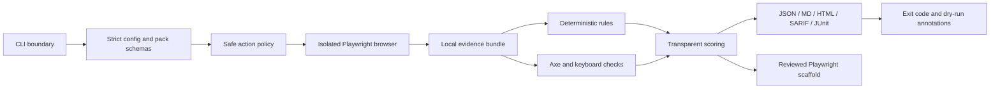
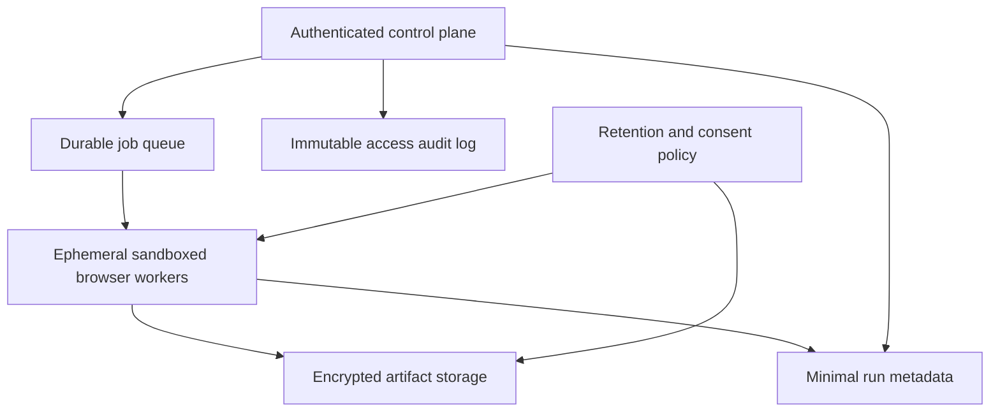

# Architecture and scaling

HumanQA v0.1 is a local CLI and evidence pipeline, not a hosted browser farm. That boundary is intentional: browser evidence can contain sensitive application data, so the default scale unit is an isolated process on the user's machine or CI runner.

## Current system

One report schema drives every output. Reporters never re-run checks or recalculate risk. Packs are validated YAML data and cannot execute arbitrary code. External AI and GitHub writes remain outside the default execution boundary.

## Runtime boundaries

| Boundary                     | Owns                                               | Does not own                                 |
| ---------------------------- | -------------------------------------------------- | -------------------------------------------- |
| CLI                          | Commands, local paths, exit semantics, diagnostics | Browser inference or report scoring          |
| Core                         | Schemas, redaction, config, report types           | I/O outside explicitly requested local files |
| Browser                      | Page lifecycle and raw browser evidence            | Product priority claims                      |
| Accessibility and heuristics | Bounded deterministic checks                       | Legal compliance or unobserved states        |
| Scorer                       | Published formulas and thresholds                  | Hidden weighting or AI output                |
| Reporters                    | Lossless format projection                         | Evidence mutation                            |
| Test generator               | Evidence-gated scaffolds                           | Unreviewed destructive test execution        |

## Reliability invariants

1. Every definite finding contains a deterministic rule or evidence reference.
2. Safe mode blocks known high-impact actions before interaction.
3. Redaction is enabled before serialized evidence becomes a finding or report.
4. A browser trace is finalized even when a journey assertion fails.
5. AI-assisted observations cannot affect deterministic release gates.
6. Reports and generated tests stay local unless the user separately uploads them.
7. CI and release publication fail on high or critical dependency advisories.

## Scale model

The current `verify` command deliberately executes Quality Contracts sequentially. This keeps browser resource use predictable and evidence ordering understandable for the expected v0.1 workload of one to ten critical journeys. A typical contract owns one browser lifecycle and one output directory.

| Signal                                         | Current response                               | Architecture trigger                                  |
| ---------------------------------------------- | ---------------------------------------------- | ----------------------------------------------------- |
| Up to 10 contracts per run                     | Sequential isolation                           | Keep current model                                    |
| Repeated requests for 10–50 contracts          | Bounded local worker pool, default 2           | Add only after memory and flake benchmarks            |
| Existing Playwright suites dominate            | Reporter ingestion                             | Avoid duplicating browser execution                   |
| Team artifact sharing is repeatedly requested  | Encrypted object storage plus retention policy | Requires explicit tenant and consent model            |
| Hosted execution is validated                  | Queue and ephemeral worker pool                | Separate control plane from untrusted browser workers |
| Cross-project release portfolios are validated | Metadata store and aggregation API             | Never centralize raw evidence by default              |

Parallel execution will require per-worker browser/context limits, collision-proof run IDs, global time budgets, deterministic aggregation, cancellation, and backpressure. It is not enabled merely to make a small local run appear distributed.

## Hosted reference architecture, if validated

The control plane must never execute user journeys. Workers need tenant isolation, egress policy, short-lived credentials, CPU and memory limits, job deadlines, and deletion guarantees. Raw DOM, traces, screenshots, and secrets must not enter analytics. A hosted system is postponed until local workflow adoption and privacy requirements are demonstrated by real users.

## Operational targets

- Local CLI startup without a browser: under 2 seconds on supported Node versions.
- A failed configuration or pack: actionable error before browser launch.
- One completed run: all declared formats written or an explicit execution failure.
- CI reliability target: at least 99% pass rate across 20 unchanged fixture reruns before adding parallel workers.
- Security maintenance: high and critical dependency advisories block CI and release publication.
- Compatibility: Node.js 20+, Windows, Linux, and macOS; Chromium is version-matched to Playwright.

These are engineering targets, not measured production claims. Benchmark evidence belongs in `docs/validation/` when collected.
