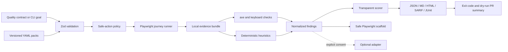

# HumanQA v0.1 implementation plan

Date: 2026-08-18  
Product wedge: **Proofrun — a local evidence pipeline for one declared, safe browser journey.**

## Definition of the vertical slice

A developer starts the included fixture, runs a YAML journey with the CLI, and receives:

- screenshots and a Playwright trace;
- visited URLs, timestamps, step results, console errors, failed responses, and timing evidence;
- raw axe results and bounded keyboard-navigation evidence;
- conservative deterministic findings with stable IDs and limitations;
- transparent priority and release-risk calculations;
- JSON, Markdown, HTML, SARIF, and JUnit reports;
- a non-destructive Playwright regression-test scaffold for a sufficiently reproducible finding;
- a CI-appropriate exit decision and a dry-run GitHub comment.

The same run must work without an LLM key. A mock adapter proves the optional interface without affecting evidence or gates.

## Explicit v0.1 non-goals

- Hosted SaaS dashboard or remote artifact storage.
- Autonomous exploration of arbitrary authenticated applications.
- Full visual-diff or session-replay platform.
- Automatic GitHub issue creation, pull requests, or non-dry-run comments.
- Broad multi-agent orchestration.
- Natural-language PRD interpretation as executable truth.
- Dozens of production-ready personas or industry-specific journeys.
- Enterprise compliance certification or legal accessibility claims.
- Screen-reader emulation or claims of full WCAG conformance.
- Expensive cloud analysis, required model APIs, or hidden telemetry.
- A full test-management platform.
- Destructive or high-impact actions in default safe mode.

## Architecture

### Package responsibilities

| Package                   | Responsibility                                               | Must not do                                      |
| ------------------------- | ------------------------------------------------------------ | ------------------------------------------------ |
| `@humanqa/core`           | Schemas, report types, config parsing, redaction, stable IDs | Launch browsers or send data externally          |
| `@humanqa/browser`        | Safe Playwright execution and raw artifact collection        | Invent usability conclusions                     |
| `@humanqa/accessibility`  | axe normalization and bounded keyboard checks                | Claim legal or complete WCAG compliance          |
| `@humanqa/heuristics`     | Conservative deterministic browser rules                     | Gate on subjective advisory observations         |
| `@humanqa/scorer`         | Priority, risk, labels, and contract thresholds              | Hide formulas or treat scores as objective truth |
| `@humanqa/reporters`      | Portable report formats from one schema                      | Mutate evidence or scoring                       |
| `@humanqa/test-generator` | Evidence-gated, non-destructive spec scaffolds               | Generate unsupported or high-impact steps        |
| `@humanqa/pack-sdk`       | Pack discovery, validation, compatibility, attribution       | Execute arbitrary pack code                      |
| `@humanqa/github`         | Markdown comments and annotations                            | Call GitHub in v0.1                              |
| `@humanqa/llm-adapters`   | Explicit optional enrichment contract and mock               | Change raw findings or CI gates                  |

## Design decisions

1. **Strong claims require declared journeys.** Goal-only audits perform a conservative page inspection and label journey completion unknown.
2. **Pack files are data, never executable code.** YAML is parsed through discriminated Zod schemas; unknown keys fail where safety matters.
3. **Safe mode is an execution policy.** High-impact labels, file uploads, payment fields, and non-loopback form submission are blocked before action unless the user explicitly enables mutations.
4. **Evidence is immutable input to analysis.** Collectors return raw values; redacted serialized copies feed findings and reports.
5. **Stable IDs are derived from rule and target.** IDs do not depend on timestamps or model output.
6. **Definite and advisory outputs are distinct.** CI thresholds count evidence-backed findings; uncertain UX observations state manual-review limitations.
7. **AI is an optional post-processing adapter.** It is disabled by default, consent-gated, failure-tolerant, separately labeled, and excluded from scores.
8. **One report schema drives every format.** Formatters cannot recalculate verdicts independently.
9. **Generated tests require reproduction evidence.** Semantic locators are preferred; unsafe steps and unknown test data are omitted with explicit review notes.
10. **Fixture defects have fixed twins.** E2E tests prove both detection and clearing, reducing fixture-only false confidence.

## Milestones and acceptance criteria

### M0 — Discovery and product contract

- Twelve concepts cover the required divergent directions.
- Scores, assumptions, validation thresholds, weekly review, feedback, experiment, and decision records exist.
- Proofrun is selected and non-goals are explicit.

### M1 — Monorepo foundation

- pnpm workspaces, strict TypeScript, linting, formatting, Vitest, build, and CI scripts are configured.
- Every requested package and application has a real responsibility and an exported entrypoint.
- CLI help exposes every requested command and safe option.

### M2 — Complete browser vertical slice

- Broken fixture journey produces screenshots, trace, browser evidence, accessibility evidence, Markdown, JSON, and at least three expected deterministic findings.
- Fixed fixture clears the seeded definite findings.
- One finding produces a syntactically valid Playwright scaffold.
- E2E tests exercise the CLI or public audit API against the fixture.

### M3 — Reports, scoring, and contracts

- Finding schema contains stable ID, category, severity, confidence, impact, effort, criticality, priority, risk, reproduction, evidence, remediation, regression candidacy, and limitations.
- Priority and release-risk formulas are unit-tested.
- JSON, Markdown, HTML, SARIF, and JUnit are emitted from one report object.
- Every format states scope or limitations; accessibility never claims complete compliance.

### M4 — Packs, skills, and GitHub boundary

- Contributors can add validated YAML without TypeScript changes.
- Seven persona, eight journey, four product-framework, and four industry starter packs exist.
- Pack fixtures, author attribution, compatibility checks, and authoring guidance exist.
- Five portable skills include evidence, privacy, safety, confidence, human-review, schema, and example guidance.
- GitHub output remains dry-run and the example Action uses local commands.

### M5 — Open-source and launch readiness

- Community health files, issue forms, pull-request template, maintainer guide, mentorship guide, and recognition plan exist.
- Twenty detailed seed issues meet the requested category counts.
- Three example configurations and expected outputs exist.
- Launch assets contain 15 X drafts, 5 LinkedIn drafts, 6 demo scripts, Product Hunt and directory plans, weekly releases, contributor activation, benchmark design, and first-user recruitment.

### M6 — Verification

- `pnpm format:check`, `pnpm lint`, `pnpm typecheck`, `pnpm test`, `pnpm test:packs`, and `pnpm test:e2e` pass from a clean install.
- The package builds and CLI help runs.
- Skill folders pass the bundled skill validator.
- The decision log records implementation evidence, remaining failures, and the next validation experiment.

## Principal risks and controls

| Risk                    | Consequence          | Control                                                                                     | Verification                                        |
| ----------------------- | -------------------- | ------------------------------------------------------------------------------------------- | --------------------------------------------------- |
| Unsafe action execution | Real-world harm      | Loopback-aware policy, deny labels, no uploads/payments, explicit mutation override         | Safety-policy unit tests and risky fixture controls |
| PII leakage             | Loss of trust        | Redaction on, offline mode, screenshot opt-out, no telemetry, report privacy metadata       | Seeded secret corpus tests                          |
| False UX claims         | Misprioritized work  | Conservative rules, advisory classification, evidence requirement, limitations              | Finding-schema invariants and fixture twins         |
| Flaky browser checks    | Unreliable CI        | Declared waits/assertions, stable IDs, deterministic fixture, timing excluded from identity | Repeated E2E runs where practical                   |
| Score anchoring         | False objectivity    | Visible formulas, threshold reasons, confidence, manual override language                   | Reporter snapshot assertions                        |
| Pack supply-chain risk  | Unsafe execution     | Data-only YAML, strict schemas, compatibility checks, prohibited action validation          | Pack fixture tests                                  |
| Monorepo complexity     | Contributor friction | Small package APIs, one root toolchain, no build-time code generation                       | Fresh-install quick start                           |
| Broad launch promise    | Expectation mismatch | “Declared journey” positioning and explicit non-goals                                       | README comprehension trial                          |

## Quality-gate semantics

- `Block release`: a critical threshold is exceeded or the contract cannot safely execute.
- `Fix before launch`: the run completes but high-confidence evidence exceeds the release threshold.
- `Plan next sprint`: medium risks are actionable but not contract-blocking.
- `Monitor`: low-risk or low-confidence signals merit observation.
- `Informational`: no actionable deterministic risk is present.

The process exit code is non-zero only for `Block release` or an execution/configuration failure by default. Teams may configure stricter thresholds later.
